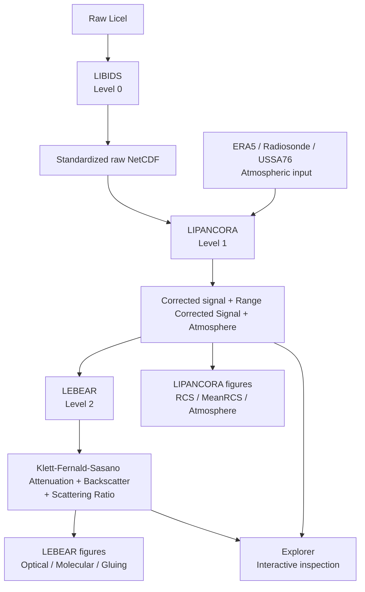

# MILGRAU 🌩️

**Multi-Indexed LALINET GeneRAlized and Unified algorithm**

MILGRAU is a Python processing suite for atmospheric elastic/Raman lidar data, developed around the long-term SPU-Lidar record operated by IPEN/USP in São Paulo, Brazil. It converts raw Licel acquisitions into traceable Level 0, Level 1 and elastic Level 2 scientific products while keeping instrument history, atmospheric state, retrieval assumptions, uncertainty semantics and provenance visible.


## Processing path



| Stage | Command | Main product |
| --- | --- | --- |
| Level 0 | `milgrau-libids` | standardized raw acquisition NetCDF |
| Level 1 | `milgrau-lipancora` | corrected signal/RCS, uncertainty and canonical atmosphere |
| Level 1 figures | `milgrau-lipancora` | RCS quicklooks, MeanRCS and atmospheric comparison |
| Level 2 | `milgrau-lebear` | selected/glued signal, molecular fields and elastic aerosol optical products |
| Web Explorer | `milgrau-explorer` | local read-only Level 1 signal inspection (Phase 1) |

See [`docs/processing_levels.md`](docs/processing_levels.md) for the stable contract of each stage.

## Current Level 2 scientific baseline

The Level 2 uses **two-sided elastic Klett–Fernald–Sasano** retrieval for configured elastic wavelengths. It preserves the validated backward branch below the selected molecular reference and retrieves forward only while contiguous measured support and the Fernald numerics remain valid. Current method includes:

- one common support mask for signal means and their reported uncertainties;
- missing signal uncertainty is unsupported, never silently converted to zero Monte Carlo noise;
- molecular calculations use the complete pressure/temperature atmosphere materialized at Level 1;
- Rayleigh reference diagnostics plus backward/forward KFS validity and endpoints are explicit;
- aggregate optical uncertainty does not treat mixed lidar-ratio/reference nuisance terms as independent noise;
- elastic extinction is conditional on the assumed aerosol lidar ratio;
- unsupported optical bins remain `NaN`; the method does not pad or promise a fixed retrieval top.

The current product and uncertainty policy are documented in [`docs/level2_schema.md`](docs/level2_schema.md). The mapping from scientific claims to code, tests, product metadata and primary literature is in [`docs/scientific_traceability.md`](docs/scientific_traceability.md).

## Installation

MILGRAU requires **Python 3.12 or newer**.

```bash
git clone https://github.com/spulidar/milgrau.git
cd milgrau
git checkout milgraumaxxing
python -m venv .venv
```

Activate the environment and install the package:

```bash
pip install .
```

For editable development/testing:

```bash
pip install -e ".[dev,explorer,web]"
```

For a shared MILGRAU + `spulidar/measurements` workspace, use `pip install -e ".[web]"`.
The `web` extra adds the publisher's optional cloud SDK (`boto3`); it does
**not** move website logic into MILGRAU. The `explorer` selector is intentionally
empty because Explorer dependencies are already in core. During development
of `measurements/publication-v2`, run only `--stage-only`: do not access
the production R2 bucket or modify `measurements/main`. See
[`docs/publication_integration.md`](docs/publication_integration.md).

ERA5 support is installed with the core package because it is the productive
Level 1 atmospheric backbone. Credentials are not stored in MILGRAU YAML or
NetCDF provenance; use the normal provider-supported `cdsapi` credential
mechanism.

The Web Explorer is included in the **core installation**, with FastAPI,
Uvicorn and Plotly; Streamlit and an optional explorer extra are no longer used.
Start the read-only local browser interface with `milgrau-explorer` from the
project directory containing `config.yaml`, then open http://127.0.0.1:8765.
See [`docs/explorer.md`](docs/explorer.md) for scope and API details.

## Quick start

With `config.yaml` and `station.yaml` resolved for the project:

```bash
milgrau-libids
milgrau-lipancora
milgrau-lebear
```

If Level 1 already exists and only figures need to be generated or repaired:

```bash
milgrau-lipancora --figures-only -i spu_20250511-0012Z_20250511-0737Z
```

Without `--force`, only missing/outdated figures are rendered. Add
`--force` to regenerate every Level 1 figure. Re-running normal
`milgrau-lipancora` also checks/repairs figures when the scientific L1 is
already current.

Level 1 heatmaps use plot-only display decimation and chunked mean-profile
statistics to keep memory bounded on long sessions; the scientific NetCDF
remains full resolution.

MILGRAU identifies scientific acquisitions as **continuous sessions**, not civil-time
publication windows. The canonical session ID is:

`station_YYYYMMDD-HHMMZ_YYYYMMDD-HHMMZ`

For example:

`spu_20250511-0012Z_20250511-0737Z`

The timestamps are UTC and use minute precision in the identifier. Exact acquisition
times remain in the NetCDF metadata. A session may cross midnight or any former
six-hour site boundary without being split. A true acquisition gap or a change in station profile/calibration starts a
new session. Inside one session, MILGRAU stores geometric solar elevation,
classifies each profile as `day` or `night` using the configured threshold,
and assigns contiguous `segXX` scientific segments. When explicitly enabled,
SCC submission derivatives are independently grouped by solar regime and UTC
calendar month under `.cache/scc/pending/<Measurement_ID>/`. The original
scientific session and its segment IDs remain unchanged.

Products are grouped by the UTC month in which the session starts:

```text
02-processed_data/
  spu/
    2025/
      05/
        spu_20250511-0012Z_20250511-0737Z/
          spu_20250511-0012Z_20250511-0737Z_L0.nc
          spu_20250511-0012Z_20250511-0737Z_L1.nc
          spu_20250511-0012Z_20250511-0737Z_L2.nc
          figures/
```

SCC integration is disabled by default (`config.yaml: scc.enabled: false`).
When enabled, LIBIDS can stage an upload-ready `raw.nc`, optional
`lr_<Measurement_ID>.nc` and checksum `manifest.json` in
`.cache/scc/pending/<Measurement_ID>/`:

```bash
# SCC-only re-export of an already scientifically processed session:
milgrau-libids -i spu_20250511-0012Z_20250511-0737Z --scc-reexport
```

This command requires the archived raw measurements and a valid existing
canonical L0 but **does not rewrite that L0**. Normal incremental processing
does not regenerate deleted cache files. Existing `*_L0_scc.nc` files from
older runs are retained without modification.

Phase 12.4 provides an **optional native SCC client** (no dependency on the
historic scc_access package). Install and validate existing packets offline:

```bash
python -m pip install -e ".[scc]"
milgrau-scc upload --dry-run
milgrau-scc status
```

Remote SCC submissions are always explicitly operator-authorized:
`milgrau-scc upload --confirm` now processes **all** locally staged packets
sequentially, skipping any Measurement_ID already present on the server.
`milgrau-scc upload --confirm --replace-existing` additionally allows
**same-ID replacement** for remote-existing packets only after verifiable
backup of the old raw measurement, LR (when present) and finished outputs.
Use `--id MEASUREMENT_ID` for one targeted upload or replacement, and
**validate a single real destructive replacement before any bulk replace**.
Both modes are stop-on-uncertainty, with a per-run summary and no automatic
POST retry. See the [operator batch and single-replacement guide](docs/scc_batch_operator_guide.md). A durable journal under `.state/scc/` records status,
checksums, backups and interrupted attempts independently of the disposable
`.cache/scc/` staging area. Uploads are never automatically initiated by
LIBIDS. Phase 12.6 adds verified read-only SCC result downloads into each
scientific session's separate `scc-results/<Measurement_ID>/generations/`
archive, and conservative cache-only cleanup after confirmed MILGRAU uploads.
Use `milgrau-scc download --id ID --session SESSION_ID --keep-cache` for
a previously existing SCC record; this does **not** authorize cleanup of its
pending local package. For a MILGRAU-journal-confirmed upload, a successful
`download --id ID` automatically cleans only its verified staging cache
when `scc.cleanup.policy: after_download`. Use `--keep-cache` to prevent
automatic deletion or `milgrau-scc cleanup --id ID --dry-run` to preview.
See [SCC client usage, recovery and security](docs/scc_native_client.md).

The primary CLIs accept a session ID, a station-local civil date, or an
explicit file/directory path. A date selects sessions that intersect that local day.
For inspection, the simplest form is positional:

```bash
milgrau-inspect 20240620
```

Processing selectors remain available through `-i`:

```bash
milgrau-libids -i spu_20250511-0012Z_20250511-0737Z --force
milgrau-lipancora -i 20250510
milgrau-lebear -i spu_20250511-0012Z_20250511-0737Z
milgrau-lebear -i spu_20250511-0012Z_20250511-0737Z --regime night
milgrau-lebear -i spu_20250511-0012Z_20250511-0737Z --segment seg01
```

The solar selectors are scientific subsets of the same session, not new session
identities. `--regime night` may include more than one disjoint night segment
if a long session contains them; `--segment seg01` selects exactly one
contiguous segment. Either selector may be intersected with
`--time-window-utc`.

LIPANCORA generates Level 1 figures automatically for the complete scientific
session, including RCS/MeanRCS plus two atmospheric views:
`AtmosphericProfile` (ERA5/USSA76 source used versus radiosonde reference) and
`AtmosphericEvolution` (hourly temperature and molecular-state evolution).
LEBEAR likewise maintains Level 2 figures beside the Level 2 product.
Visualization is therefore a responsibility of the processing level that owns
the underlying scientific product, not a separate pipeline.

Explicit UTC subsetting remains available for derived Level 2 products:

```bash
milgrau-lebear -i spu_20250511-0012Z_20250511-0737Z --time-window-utc 01:00 03:00
milgrau-lebear -i spu_20250511-0012Z_20250511-0737Z --regime night --time-window-utc 01:00 03:00
```

Public-site windows such as 00–06, 06–12, 12–18 and 18–24 are publication views
and are intentionally not MILGRAU session identities.

Shell status is deliberately operational. Scientific QA belongs in the NetCDF
diagnostics rather than being compressed into an exit code.

## Configuration 

MILGRAU keeps responsibilities separate:

- **`config.yaml`** — processing/scientific recipe: how the run should be processed;
- **`station.yaml`** — observational reality: station/instrument history, calibration identity and station-derived information;

Institutional logos for **all Matplotlib Level 1 and Level 2 figures** are
controlled by `visualization.logos` in `config.yaml`. The default selects
`img/LEAEL_LOGO.png` alongside the CC and LALINET marks. Replace a path to use
your own PNG/JPEG/WebP, reorder entries, change `height`, or use `logos: []`
to hide them completely. For example:

```yaml
visualization:
  logos:
    - path: "img/my_institute_logo.png"
      height: 0.065
```

A bare filename resolves from `img/`; a relative path containing folders
resolves from the project root. Absolute paths are also supported.
`height` is a fraction of figure height; figures place logos from right to
left at the bottom. Missing images are skipped. Editing a selected image
regenerates figure assets on incremental runs without recomputing scientific
NetCDF products.

The exact ownership boundary and hash/provenance policy are documented in [`docs/configuration_ownership.md`](docs/configuration_ownership.md). The canonical code-owner inventory is in [`docs/code_inventory.md`](docs/code_inventory.md).

Published NetCDF provenance embeds the exact processing/station YAML snapshots. Level 2 also identifies exact upstream Level 1 bytes and the installed MILGRAU Python source content, so scientific input/code states can be distinguished without relying on machine-local paths.

## Documentation map

- [`docs/processing_levels.md`](docs/processing_levels.md) — stable Level 0/1/2 responsibilities and boundaries.
- [`docs/configuration_ownership.md`](docs/configuration_ownership.md) — `config.yaml` vs `station.yaml` vs Python ownership.
- [`docs/code_inventory.md`](docs/code_inventory.md) — canonical module/API ownership.
- [`docs/atmospheric_profiles.md`](docs/atmospheric_profiles.md) — radiosonde/ERA5/USSA76 atmosphere handling.
- [`docs/explorer.md`](docs/explorer.md) — local, read-only Web Explorer architecture and usage.
- [`docs/level2_schema.md`](docs/level2_schema.md) — current Level 2 NetCDF schema, support, uncertainty and provenance semantics.
- [`docs/scientific_traceability.md`](docs/scientific_traceability.md) — scientific traceability matrix and verified bibliography.
- [`.github/tracker.md`](.github/tracker.md) — scientific engineering roadmap and acceptance gates.


## Citation

If you use MILGRAU, cite the software using [`CITATION.cff`](CITATION.cff). The current source version is recorded in `CITATION.cff` and `milgrau/version.py`. The historical Zenodo DOI `10.5281/zenodo.20330638` refers to an earlier deposit and is not claimed as the archival DOI for the present source.


## License

MILGRAU is distributed under the MIT License; see [`LICENSE`](LICENSE).
